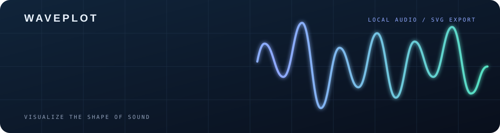

# Waveplot

A private, browser-only audio waveform viewer. Drop in a local audio file, inspect its waveform, and export a lightweight SVG.

## Features
- Open audio files from your device using drag and drop or the file picker.
- Decode audio locally with the browser's Web Audio API.
- View a compact waveform and inspect duration, channels, and sample rate.
- Play the selected audio in the browser.
- Export the waveform as a standalone SVG.
- No upload, account, server, or third-party library.

## Run
Open `index.html` in a modern browser. No installation or build step is required.

## Compatibility
Audio decoding depends on formats supported by the browser. Large files may use substantial memory.

## Privacy
The selected file is processed locally in the page. Waveplot does not transmit audio data.

## License
MIT